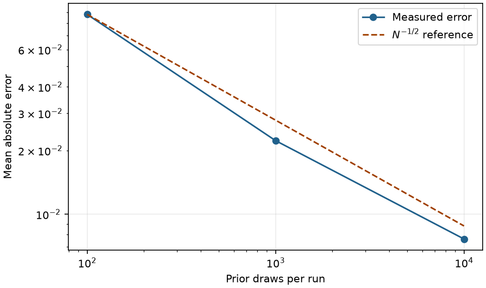

<div align="center">
  <h3>Bayesian Inference with ProbLog</h3>

  <p>
    Bayesian networks with <strong>exact inference</strong>,
    <strong>sampling benchmarks</strong>, and <strong>causal interventions</strong>.
    <br />
    <a href="#-getting-started"><strong>Quick Start »</strong></a>
  </p>

  <p>
    
    
    
  </p>
</div>

## 🔍 About The Project

The burglary alarm, noisy-OR fever, and sprinkler networks show how evidence
changes probabilities and how interventions change the model. The sprinkler
benchmark measures sampling error against exact posteriors and compares
rejection sampling with likelihood weighting at equal draw budgets.

## 🛠 Built With

- **ProbLog 2** for probabilistic logic models, exact inference, and prior samples.
- **Python 3.9+** for running queries across evidence sets and comparing sampling methods.
- **Matplotlib** for the log–log error plot.

## 📐 Architecture

### Technical Highlights

- **Exact inference.** The sprinkler model runs three subqueries with separate
  evidence sets and prints their posteriors in one command.
- **Sampling.** Rejection sampling filters prior worlds by evidence. Likelihood
  weighting fixes the evidence and weights each world by its likelihood.
- **Causal inference.** Sprinkler interventions replace the sprinkler rule.
  Adjustment on Cloudy or Rain recovers the intervention probability.

### File Organization

```text
├── models/                     # Burglary, fever, and sprinkler networks
├── scripts/
│   ├── exact.py                 # Exact queries and causal adjustment
│   └── sampling.py              # Estimator comparisons and error plot
├── assets/rejection-error.png
└── requirements.txt
```

## 🚀 Getting Started

Use Python 3.9 or newer and a GitHub account with access to the repository.

```sh
git clone https://github.com/EnzoPicarel/bayesian-inference-problog.git
cd bayesian-inference-problog
python3 -m venv .venv
source .venv/bin/activate
python -m pip install -r requirements.txt
```

## ⚡ Execution

```sh
problog models/sprinkler.pl
python scripts/exact.py
problog sample models/sprinkler_prior.pl -N 200000 --oneline --seed 42 > samples.txt
python scripts/sampling.py samples.txt --compare
```

The sampling script uses 20 runs per sample size and writes
`sampling-error.png`.

## 📊 Results

For rain given that the sprinkler is on, the exact probability is **0.3000**.
The fitted rejection-sampling error slope was **−0.5308**, close to the
expected **−0.5**.



For rain given cloudy and wet grass, the exact probability is **0.9758**.
The table compares mean absolute error for that query.

| Draws per run | Rejection sampling | Likelihood weighting |
| ---: | ---: | ---: |
| 100 | 0.0152 | 0.0131 |
| 1,000 | 0.0083 | 0.0032 |
| 10,000 | 0.0022 | 0.0013 |

The probability of greener grass was **0.6643** with the sprinkler forced on
and **0.3425** with it forced off. Both Cloudy and Rain adjustment reproduced
the sprinkler-on result.

## 🧪 Tests

Run each model directly to check that it loads and prints its queries.

```sh
for model in models/*.pl; do
  problog "$model" || exit 1
done
```

The exact-inference script reproduces the burglary posterior of **0.2842**
given both calls and the sprinkler posterior of **0.3000** for rain given
that the sprinkler is on.
